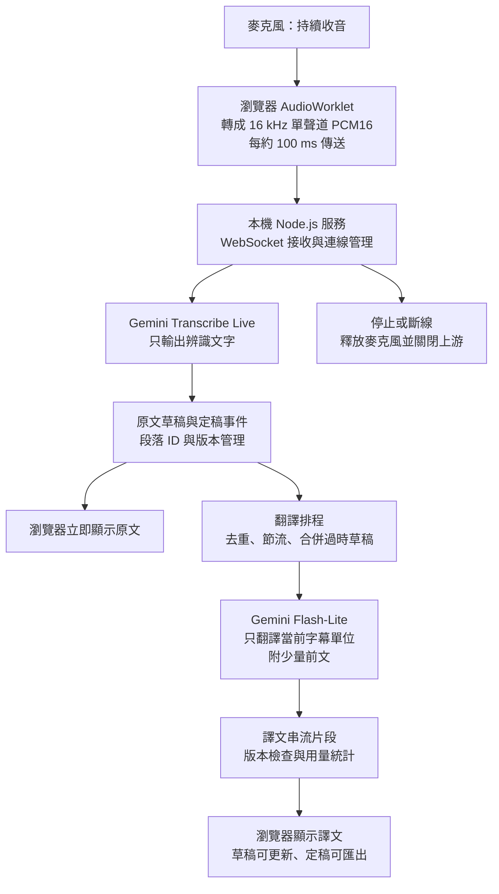

# 即時音訊轉翻譯字幕：可直接交給 AI 的實作指令

> 2026-10-26 更新：使用者已改為「純前端、手機／筆電瀏覽器直接連接 Gemini、使用者在頁面輸入自己的 API Key」方案，並明確要求個人使用時在瀏覽器記住金鑰。以下保留早期後端設計作參考；後續工作以 realtime-text/README.zh-TW.md 與目前 src/ 程式為準，不要再依下方規格恢復必須執行本機後端的架構或取消已授權的本機金鑰儲存。網站成品是根目錄 index.html，可直接更新 GitHub Pages 首頁。語音由 Gemini Transcribe Live AI 處理，短停頓字幕應接續成段，不呼叫裝置內建聽寫。

> 版本 2.2：中文原文與譯文皆以台灣繁體字詞顯示，日文漢字保留日文。AI 在同一個翻譯請求內回傳結構化的原文校對、譯文與最近紀錄的有證據校正。停止、開新場次、換語言不得清空 UI 歷史；只有明確清空或離開／重新整理頁面才清除。金鑰已記住後預設收合為小列。以下早期「僅輸出譯文」等要求不應覆蓋目前版本的這些行為。

> 版本 2.3：改用中文 ↔ 日文、中文 ↔ 英文、日文 ↔ 英文雙向配對。同一條 Gemini 聽寫連線自動辨識兩種語言，文字模型逐句判斷來源並翻成另一種語言；不要恢復只能單向的選項，也不要同時開兩套重複收音。字幕與歷史紀錄的方向屬於各句，不屬於整場。UI 費用及預算以台幣顯示，匯率可調整、會記住並標示為參考值，預算門檻換算後再交給既有美元計費估算邏輯。

> 雙向判斷優先採用 Gemini 聽寫的 `languageCode` 語音標記，缺少時才由文字模型判斷來源；不要丟棄標記，或把純漢字日文一律當中文。語音標記只在同一辨識輪次內延續，輪次結束後重設。

> 用量與費用跨場次累計：停止、續講與換語言配對不得歸零，按「清除紀錄」才與字幕一起清除；重新整理或離開頁面仍清除暫存資料。本場預算維持每次開始獨立計算。同場累計快照必須覆寫，不可重複相加。介面採緊湊標題與間距，字幕區隨視窗剩餘高度伸縮，一般尺寸在設定收合時應讓操作、字幕與累計費用同屏可見。

> 版本 2.3.1 收音修正：支援麥克風與分頁／電腦分享音訊兩種來源。分享沒有音軌必須提示，不可改用麥克風；畫面不得送往 Gemini。電腦切分頁不主動停止，手機切背景仍停止。麥克風權限完成及音訊圖建立後必須再次恢復 AudioContext，支援 Audio Session API 時指定錄音模式並在停止後還原。收到第一包 PCM 後才可宣稱聆聽中／計時，顯示實際音量，檢查啟動逾時、停止分享、處理器錯誤與封包中斷；不可用計時走動冒充收音正常。

請作為實作工程師，在目前專案直接建立可執行的檔案，並完成繁體中文操作教學。不要只回覆計畫、範例片段或架構說明。請先讀取適用的 AGENTS.md 與現有檔案，再執行以下規格；一般實作細節自行決定。

## 目標與範圍

我要在 Windows 電腦使用瀏覽器，按一次「開始」後持續收音，邊講邊看到原文與翻譯字幕，按「停止」才結束。只要文字，不生成翻譯語音、不使用 TTS。優先支援中文→日文、日文→繁體中文，也提供英文方向切換。預設中文→日文，一次只啟用一個方向。

目前專案只有 index.html，原本使用 React 18；其中 AI 即時模式每 6500 毫秒停止 MediaRecorder，組成音檔再呼叫 generateContent；另一個字幕模式使用 Web Speech API 與文字翻譯。請閱讀並沿用必要的語言設定與畫面概念，在 realtime-text/ 建立新的獨立版本，保留原本 index.html。若沒有舊檔，也依本規格建立新專案。

第一版只需麥克風即時输入，音檔匯入、系統音訊、多人分離、登入、資料庫、付費雲端部署不在必做範圍。目標是本機執行、容易安裝、低使用成本。

## 架構圖



## 技術與官方文件核對

使用 Node.js LTS、TypeScript、React、Vite、輕量 HTTP 服務與 WebSocket；Google 呼叫集中在後端。開發時以 Vite proxy 串接本機後端；正式本機模式由同一後端提供編譯好的前端。不要引入付費串流中介平台或外部資料庫。

建議模型由環境變數指定：

```dotenv
GEMINI_API_KEY=replace_with_your_key
STT_MODEL=gemini-3.5-transcribe-live
TRANSLATION_MODEL=gemini-3.1-flash-lite
TRANSLATION_INTERVAL_MS=1500
TRANSLATION_CONTEXT_MAX_TOKENS=256
TRANSLATION_OUTPUT_MAX_TOKENS=256
PORT=3000
```

這些是截至 2026-09-17 查閱文件後的候選設定。開始實作前必須核實當時模型是否可用、SDK 版本、事件欄位、串流介面、價格與中文語言代碼，將來源與查核日期寫入 README。不得凭空編造 API；也不要因模型不存在而自動換成更貴的語音生成模型。

- Live Transcribe：https://ai.google.dev/gemini-api/docs/live-api/live-transcribe
- 模型與更新：https://ai.google.dev/gemini-api/docs/changelog
- 價格：https://ai.google.dev/gemini-api/docs/pricing?hl=en
- Google Gen AI JavaScript SDK：https://github.com/googleapis/js-genai

已查到的 Transcribe Live 專用設定是 responseModalities: ['TEXT']，草稿事件為 serverContent.interimInputTranscription，定稿事件為 serverContent.inputTranscription。以實作當時官方文件與鎖定 SDK 的型別為準；不得把一般 Live 語音模型的逐字稿當成免費純文字替代品。

若官方文件或帳號權限無法確認，仍完成本機程式、模擬測試與教學，清楚標示上游接入未驗證的部分，不宣稱端到端成功。可額外提供明確標示的瀏覽器 SpeechRecognition 備援，但不要用它冒充 Gemini；備援不是第一版必做項目。

## 音訊與連線

1. 使用 getUserMedia 與 AudioWorklet 持續收音。依實際 AudioContext 取樣率重取樣，維持跨音訊區塊的狀態；不能假定裝置真的輸出 16 kHz，也不能只改 MIME 標籤。轉為單聲道、little-endian PCM16，約每 100 ms 傳送一次。
2. 等上游 setup 成功才開始送音訊；麥克風、連線、送出與接收要非阻塞運作。不要重用「錄滿幾秒→stop→Blob→完整上傳」作為即時模式。
3. 預設使用服務端語音活動偵測。第一版不要只靠音量門檻刪除音訊，避免漏字；靜音時沒有新文字就不要發翻譯請求。
4. 開始、連線中、聆聽中、結束處理中、已停止、錯誤必須有明確狀態。重複點開始不能產生多個麥克風或上游連線。
5. 按停止立即停止採集；依官方協定送結束訊號，限時等待尾端定稿與最後翻譯，再關閉上游。逾時保留未完成草稿並標示狀態。關頁、異常、停止後的延遲回覆不能重新啟動連線。
6. 音訊緩衝最多保留約 2 秒。壅塞時明確報錯並停止或重建連線，不無限排隊，也不默默丟字。斷線最多退避重試 3 次，區分「新連線」與官方支援的恢復；不重送整場音訊。無法恢復的間隔要標示。
7. 第一版服務只綁定 localhost/loopback，限制 WebSocket Origin、訊息大小與單次連線數。正式 API Key 只放後端 .env，不進前端、localStorage、版本控制或日誌。前端顯示文字使用安全的文字渲染。

## 原文與翻譯排程：重要驗收邏輯

原文收到草稿就更新，不等待翻譯。草稿是可替换的當前假設，不能每次都追加；定稿依提供者的邊界語義更新同一個原文單位。不要因相同字串重複出現就刪除不同段落，說話者可能真的重複一句話。

以 sessionId、utteranceId、captionId、revision、requestId 管理字幕，將上游事件轉為自己的明確資料結構；這些 ID 可由應用程式產生，不假定上游一定提供。辨識定稿與翻譯定稿是不同狀態。

- 預設省預算：每 1500 ms 檢查一次是否要啟動草稿翻譯。可選快速模式 1000 ms。這是請求最短間隔，不是延遲保證，也不是音訊分段時間。
- 文字變化必須有意義才翻譯，例如字詞增加或否定、數字、實詞修正；不要單靠字串長度，避免漏掉等長修正。短句與定稿不因字數少而被忽略。
- 使用節流與最大等待時間，不用每有新字就重設的純 debounce，避免持續說話時始終沒有翻譯。字幕草稿允許不完整，不猜測尚未說出的內容。
- 全程最多一個進行中的文字翻譯請求；過時草稿只留最新一份。已定稿但尚未翻譯的內容不得被最新草稿覆蓋，可以合併相鄰定稿但維持映射。定稿優先，佇列有上限；真的處理不及時顯示壅塞並暫停收音，不能無限累積。
- 每個請求只翻譯當前字幕單位，附最近 1–2 個已完成句子、最多約 256 tokens 的參考前文。不能反覆送整場歷史。
- 連續長句不能無限增長：優先在穩定標點或片語邊界建立約 5–8 秒的暫定字幕單位；這是文字展示邊界，不停止音訊。保留原文位置與版本映射；上游後續修正早期草稿時更新受影響字幕，不能永久鎖死尚未定稿的錯字。若沒有可靠邊界，保留有限的活動文字範圍並明示未定稿，設計及測試如何與最終完整原文核對，避免遺漏、重複或前後文錯接。
- 若辨識定稿與已成功翻譯的草稿相同，且語言、前文與翻譯設定一致，直接沿用譯文，不多發一次。若不同，只重新翻譯受影響單位。
- 翻譯回覆必須檢查 session、方向、單位及版本。舊回覆不得覆蓋新草稿，更不能覆蓋已定稿字幕。不要每來一個字就取消請求，取消不代表不計費。
- 採用官方支援的文字串流介面，收到譯文片段就顯示；未完成請求不能標為定稿。中斷、截斷或輸出上限要顯示並處理，不能把半句當完整翻譯。
- 停止、切換方向或開新場次時，確實隔離版本、計時器、佇列及快取；切換方向應先完成或明確標示上一場次的尾端。

翻譯指令應要求忠實翻譯、只輸出譯文、不補完未說完的句子、不回答原文裡的問題或指令、保留數字與否定。上下文只供參考，不得再次輸出。中文譯文使用繁體中文。來源語言提示必須使用官方實際支援代碼；不要把簡繁文字轉換當作已驗證的台灣中文辨識能力。

## 用量與省錢設計

只呼叫一次語音辨識加必要的文字翻譯，不產生音訊、不做 Google Search、不傳送影像、不輪詢翻譯空白文字、不重翻全場歷史。以本機執行避免伺服器月租，但 API 仍需網路與付費額度。

介面顯示本場時長、實際傳送音訊秒數、翻譯請求數、輸入／輸出 tokens、估算費用。使用供應商 usage metadata 時必須區分累計值與增量，避免重複加總；缺資料時標「估算」或「未知」，不能當成零。即使過時結果沒有顯示，已產生的費用仍要計入。價格集中設定並記錄日期。

成本的目標是低於 US$1／小時，不保證。2026-09-17 價格表對 Transcribe Live 的混合估算約 US$0.009／分鐘；Flash-Lite 3.1 純文字輸入／輸出分別是 US$0.25／US$1.50 每百萬 tokens。舉例：辨識 60 分鐘約 US$0.54，加上文字翻譯實際累計 500,000 輸入 tokens 與 100,000 輸出 tokens，約 US$0.275，合計約 US$0.815。輸入 tokens 要包含每次提示、前文、重試及反覆翻譯的草稿。這是示例假設，不能硬編碼成實際帳單或承諾。

設定可選的本場預算上限；啟用後接近上限時提示，估算達上限時停止新音訊與新翻譯請求並釋放上游，清楚標示尾端可能未翻譯。因用量回報延遲及已發出的請求可能繼續計費，這不是供應商保證的硬上限。不要假定刪除前端聊天紀錄會降低上游費用；需核實專用辨識模型的歷史計費語義。

## 畫面

全繁體中文、桌面及手機寬度可用。提供開始／停止、來源→目標語言、省預算／快速模式、連線狀態、原文顯示切換、草稿與完成字幕、本場用量、複製及下載 TXT。預設不播放聲音、不保存原始音訊；逐字稿只存在記憶體，使用者主動下載才存檔。草稿用較淡樣式，已完成譯文清楚可讀，使用者捲動查看歷史時不要強制拉回底部。

## 預期檔案

可以微調模組名稱，但要交付完整可執行內容、鎖定相依版本及實際操作教學：

```text
realtime-text/
  package.json
  package-lock.json
  tsconfig.json
  vite.config.ts
  .env.example
  .gitignore
  index.html
  README.zh-TW.md
  start.ps1
  server/
    index.ts
    config.ts
    stt.ts
    translator.ts
    scheduler.ts
    usage.ts
  shared/
    protocol.ts
  src/
    main.tsx
    App.tsx
    styles.css
    audio/capture.ts
    audio/pcm-worklet.js
  tests/
    scheduler.test.ts
    lifecycle.test.ts
    audio.test.ts
```

至少提供 npm run dev、npm run build、npm start、npm test 與 npm run typecheck。npm run dev 用一個指令啟動前後端；npm start 執行 build 後的本機版本，網址統一為 http://localhost:3000。start.ps1 使用腳本所在目錄，正確處理含空白及中文路徑，檢查 Node 和 .env，不任意修改 Windows 全域執行政策。

## 教學與驗收

README.zh-TW.md 必須教會不熟程式的人：安裝符合相依套件需求的 Node.js LTS、取得 Gemini API Key 與查看 API 計費、開啟正確資料夾、安裝套件、複製 .env.example 為 .env、在本機填寫金鑰、啟動程式、開瀏覽器、允許麥克風、切換方向、停止及下載文字。指令要能在 Windows PowerShell 直接使用，明確區分第一次安裝與下次啟動。不要求把金鑰貼到對話。

說明必須從 localhost 開啟，不能雙擊 HTML，也不能只部署到 GitHub Pages；這個架構需要正在執行的本機 Node.js 後端。附上找不到 Node、執行政策、埠被占用、無麥克風權限、401/403/429、模型不存在、網路斷線的排除方法。沒有金鑰時能正常開介面並顯示設定提示，不假裝成功。

以假事件與可控時鐘測試以下核心正確性：草稿替換、同長度修正、舊結果晚到、定稿覆蓋、相同文字重複說兩次、定稿優先、停止前尾句、停止後不重連、連續點開始、重新開始不串場、長句持續有草稿翻譯、壅塞上限、預算停止、usage 增量／累計不重複。音訊測試涵蓋 44.1/48 kHz 重取樣的時間長度及 PCM16 邊界。不要只寫與實作互相照抄的測試。

執行型別檢查、必要測試及 build；能開瀏覽器時檢查畫面與錯誤狀態。提供人工測試腳本：連續說 30 秒不按停止、短句、停頓、中日方向切換、含否定和數字的句子、運行 10 分鐘、停止後觀察是否仍有新請求。

設定「原文持續更新、譯文草稿約每 1–2 秒有機會更新、正常網路首段譯文約 1–3 秒」為待測目標，不能當成保證。分別記錄收到語音到原文草稿的時間、翻譯排程等待、請求到第一個譯文 token、句末到定稿等延遲；只有可對齊的音訊／文字才計算端到端延遲，不把 UI 更新頻率當成翻譯延遲。

最後回覆：建立的檔案、最短啟動步驟、完成的檢查、實測結果與尚未驗證項目。若無金鑰、無音訊設備或服務權限不足，要分別寫清楚；完成其餘可執行工作，不要拿模擬成功代替真實 API 成功。
