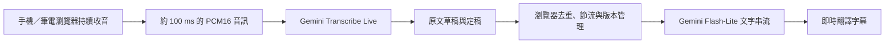

# 即時翻譯字幕：手機／筆電純前端版

這一版在瀏覽器直接連接 Google Gemini，持續收音、持續更新原文與翻譯文字。手機與電腦使用同一個 HTTPS 網址，使用時不用開著筆電，也不用安裝 Node.js。API Key 由你在網頁輸入，重新整理後即清除。

**與舊版的差別：不需要 `.env`、不需要本機翻譯後端、不需要在手機安裝任何工具。** 保留的 `server/` 與 `.env.example` 只是舊版原始碼參考，沒有被新版網頁或預設指令使用。現有 `.env` 沒有被修改，也不要上傳到 GitHub。

## 最簡單使用方式：上傳單一 HTML

專案外層（與原本 `index.html` 同一層）有一個 **`realtime.html`**，已經打包好，包含所有必要畫面、程式與收音工作模組。使用者不需要自行編譯。

1. 把 `realtime.html` 上傳到你已啟用 GitHub Pages 的 repository 發佈資料夾。
2. 等候 Pages 更新，用手機或電腦開啟該站的 **HTTPS** 網址，最後加上 `/realtime.html`。
3. 在畫面的「你的 Gemini API Key」貼上自己的 Key。
4. 選擇翻譯方向，按「開始聆聽」，允許麥克風。
5. 等到「聆聽中」再開始講話。原文與譯文會持續補上，尚未定稿的內容會更新。
6. 按「停止」等待收尾，可以複製或下載 TXT。

例如你的 Pages 網址是 `https://你的帳號.github.io/你的專案/`，這個版本就放在 `https://你的帳號.github.io/你的專案/realtime.html`。原本的 `index.html` 可以繼續當舊版首頁。

若 Pages 發佈來源設定成 `/docs`，請上傳到該 `docs` 資料夾。若這是一個全新的獨立網站，也可以只把 `realtime.html` 改名為 `index.html` 上傳到新 repository。

**請上傳網頁成品，勿上傳 `.env`、API Key 或 `node_modules`。** 不要把自己輸入過的 Key 寫回 HTML，這個檔案只應包含空白輸入欄位。

## 第一次設定 GitHub Pages

1. 在 GitHub 選擇或建立一個 repository，把網頁成品上傳到你要發佈的分支。
2. 開啟 repository 的 **Settings → Pages**。
3. 在 **Build and deployment → Source** 選 **Deploy from a branch**。
4. 選擇存放 `realtime.html` 的分支及資料夾，按 Save。
5. 等待網站建立後，使用 Pages 顯示的網址，並確認已啟用 **Enforce HTTPS**。

如果已經有 GitHub Pages，不必重新設定，只要把這個檔案加到現有的發佈位置。這次修改沒有把檔案推送到 GitHub，也尚未替你公開發佈網站。

## 另一種部署：讓 GitHub 自動建置

想繼續改原始碼時，可上傳整個專案到 GitHub，使用已附上的 `.github/workflows/realtime-pages.yml`。

1. 將專案推送到 GitHub，保留 `realtime-text/` 與 `.github/workflows/` 的資料夾位置。
2. 在 **Settings → Pages → Source** 選擇 **GitHub Actions**。
3. 在 **Actions** 選擇 **Deploy realtime subtitles to GitHub Pages → Run workflow**。
4. 等待建置與部署完成，開啟執行結果中的網站網址。

這個工作流程是手動觸發，會測試並建置 `realtime-text/dist`，再將它發佈為網站首頁。它不需要也不應設定 Gemini API Key secret。這個方法會以新版取代該 repository 的 Pages 首頁；若要保留原首頁，使用上面的單一 HTML 方法。

GitHub Pages 適合目前的純前端需求，沒有必要先換平台。若你已有其他支援 HTTPS 的靜態網站空間，把 `realtime.html` 或 `dist` 內容放上去也可以。

## 手機使用

- 建議用新版 iPhone Safari 或 Android Chrome，從一般瀏覽器開啟，避免通訊軟體內建瀏覽器。
- 必須有網路，並允許這個網站使用麥克風。
- 開啟後輸入自己的 API Key；Key 只存在這次頁面記憶體，不存進 localStorage、sessionStorage 或瀏覽器網址列。連接 Google 的加密 WebSocket 依官方協定使用金鑰驗證。
- 請保持頁面在前景。程式會嘗試讓螢幕保持亮著；鎖屏或切換 App 時會主動停止，返回後按開始可開新場次。
- 開始下一場次會清除上一場字幕，需要留存請先下載。
- 文字翻譯本來就需要理解部分語意，不能保證每個字都零延遲，也不能保證每一秒都有完整譯句。

電腦與手機的瀏覽器各自輸入 Key，不需要讓手機連回筆電。把檔案傳到手機並從檔案管理員直接打開，並不是建議的執行方式，請使用發佈後的 HTTPS 網址。

## 取得 API Key 與錯誤排除

到 [Google AI Studio](https://aistudio.google.com/apikey) 取得自己的 Gemini API Key。請確認專案有可用額度，且帳號能使用指定模型；Gemini 網頁版訂閱不等於這個 API 的使用額度。

- **麥克風按鈕無法使用**：確認網址以 `https://` 開頭，並改用新版 Safari／Chrome。若直接雙擊 HTML，程式會提示你改用 HTTPS 或 localhost。
- **麥克風被拒絕**：在瀏覽器網站權限允許麥克風，再重新開始。
- **HTTP 400／401／403 或語音連線 1008**：檢查 API Key、模型存取權、地區／帳單與 Key 的 API／網站限制。錯誤若提及模型不可用，先查官方模型頁，不會自動替你換成較貴的語音生成模型。
- **HTTP 429**：用量或請求速度達上限，請查看 AI Studio 用量，改省預算模式或稍後再試。
- **連線 1006、網路或瀏覽器連線錯誤**：檢查網路與服務權限。字幕會保留，重新開始一場；不重送已聽過的整場錄音。
- **網頁顯示舊版**：確認開的是 `/realtime.html` 或新版部署網址，重新整理；GitHub 上的檔案檢視頁不是已發佈網站。
- **沒有安裝 npm**：如果只是用手機／筆電開發佈後的網頁，完全不需要 npm。只有修改原始碼後自行建置才需要它。

## 只有開發與本機預覽才需要 Node.js

網站成品已經提供。想改原始碼、重新打包時，才需要安裝 Node.js LTS 20.19 以上（含 npm）。Windows PowerShell 請進入 `realtime-text` 後執行：

```powershell
npm.cmd install
npm.cmd run typecheck
npm.cmd test
npm.cmd run build
npm.cmd start
```

建置會更新 `dist/` 與外層的 `realtime.html`。本機預覽網址為 <http://localhost:3000>。`npm.cmd start` 只是靜態檔案預覽器，不會代理 Gemini 或讀取 `.env`，所以使用後仍在網頁輸入 Key。

日常修改也可用 `npm.cmd run dev`。`start.ps1` 可以預覽已建置的網站；有 Node.js 與 `dist` 即可，不要求 npm 或 `.env`。PowerShell 執行政策若擋住，可改用 `node scripts/serve.mjs`，不需更改全系統政策。

已附 `pnpm-lock.yaml` 鎖定相依套件，GitHub workflow 會使用它。熟悉 pnpm 的使用者也可執行 `pnpm install --frozen-lockfile --ignore-scripts`，再用 `pnpm run build`。

## 架構與費用



音訊不經你自己的伺服器。省預算模式最多約每 1.5 秒啟動一次翻譯，快速模式約 1 秒；這是排程間隔，不是翻譯延遲保證。原文先更新，已有的翻譯前綴可以先顯示，等新內容到達再修正。長句切成有限長度的文字單位，不會停止收音；定稿若修正早期文字，會更新對應單位。

費用是「辨識音訊＋必要的文字翻譯」，沒有語音生成費。每次只翻目前字幕及少量前文，已完成的相同內容優先沿用快取。語音費用按送出的秒數估算，文字費用優先採用 API usage metadata；無 metadata、失敗或中斷的請求按字數估算。SSE 中同一請求的累計 metadata 不會重複相加。

2026-10-26 查閱價格：Transcribe Live 官方混合範例約 US$0.009／分鐘；Flash-Lite 3.1 每百萬文字輸入／輸出 tokens 約 US$0.25／US$1.50。這些值集中於 `src/lib/config.ts`。它們不是帳單保證，辨識文字輸出、上下文、重複草稿、取消與已發出的請求都可能影響實際帳單。預算停止是本機估算值的保護，不能代替供應商帳單上限。

官方來源：

- [瀏覽器直接連接 Live API](https://ai.google.dev/gemini-api/docs/live-api#choose-an-implementation-approach)
- [純文字串流辨識、草稿與定稿欄位](https://ai.google.dev/gemini-api/docs/live-api/live-transcribe)
- [文字翻譯模型](https://ai.google.dev/gemini-api/docs/models/gemini-3.1-flash-lite)
- [Flash-Lite 思考設定](https://ai.google.dev/gemini-api/docs/generate-content/thinking)
- [Gemini API 價格](https://ai.google.dev/gemini-api/docs/pricing?hl=en)
- [GitHub Pages 建站](https://docs.github.com/en/pages/getting-started-with-github-pages/creating-a-github-pages-site)
- [GitHub Pages HTTPS](https://docs.github.com/en/pages/getting-started-with-github-pages/securing-your-github-pages-site-with-https)

語音模型預設為 `gemini-3.5-transcribe-live`，翻譯模型為 `gemini-3.1-flash-lite`。中文辨識採官方列出的普通話提示 `cmn-Hans-CN`，日文 `ja-JP`，英文 `en-US`；要求中文譯文使用繁體中文。台灣口音的準確度仍需要真實裝置測試。

## 第一次實際測試

1. 先用 HTTPS 網頁輸入 Key，連續說話 30 秒，不按停止，觀察原文與譯文是否持續出現。
2. 說「我今天不會買 15 個」，改口為「我要買 50 個」，確認否定及數字修正能反映在字幕。
3. 按停止，確認最後一句保留；未完成字幕會標示為草稿。
4. 切成日文 → 繁體中文後再開始，確認沒有混入上一場內容。
5. 手機切換 App 再返回，確認已停止而沒有假裝繼續聆聽。
6. 下載 TXT，確認完成字幕與草稿都有正確標記。

自動測試使用假音訊／模擬服務，不需要 Key，也不會產生 Gemini 費用。它們驗證排程、版本、尾句、用量與串流處理，不能代替手機實機與 Gemini 帳號的端到端驗證。
