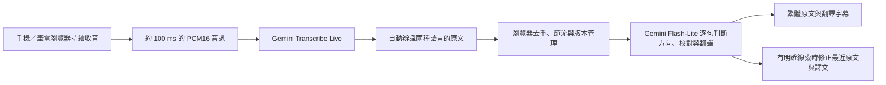

# 即時翻譯字幕：手機／筆電純前端版

這一版在瀏覽器直接連接 Google Gemini，持續收音、自動判斷每句語言並雙向翻譯，費用以台幣估算。手機與電腦使用同一個 HTTPS 網址，使用時不用開著筆電，也不用安裝 Node.js。API Key 貼上後會自動記住，重新整理或下次開啟會帶入；按「清除」即可刪除。

**與舊版的差別：不需要 `.env`、不需要本機翻譯後端、不需要在手機安裝任何工具。** 保留的 `server/` 與 `.env.example` 只是舊版原始碼參考，沒有被新版網頁或預設指令使用。現有 `.env` 沒有被修改，也不要上傳到 GitHub。

## 最簡單使用方式：上傳單一 HTML

專案根目錄的 **`index.html`** 已經打包好，包含所有必要畫面、程式與收音工作模組。使用者不需要自行編譯。

1. 把根目錄的 `index.html` 上傳到你已啟用 GitHub Pages 的 repository 發佈資料夾，取代同名舊檔。
2. 等候 Pages 更新，用手機或電腦開啟該站的 **HTTPS** 首頁網址。頁尾顯示「版本 2.3.1」代表已更新。
3. 在畫面的「你的 Gemini API Key」貼上自己的 Key，之後同一瀏覽器會自動帶入。
4. 選擇雙向配對：**繁體中文 ↔ 日本語、繁體中文 ↔ English、日本語 ↔ English**，按「開始聆聽」，允許麥克風。
5. 等到「聆聽中」再開始講話。同一配對的兩種語言可直接輪流說，不必停止或切換方向；例如講日文就出繁體中文，講中文就出日文。
6. 按「停止」等待收尾，可以複製或下載 TXT。
7. 想換另一組語言時，停止後選新配對，再按「繼續聆聽」。先前紀錄會保留，各句及下載的 TXT 都標示自己的實際翻譯方向。

Key 已記住時，設定區只顯示一條小列；按「更改金鑰」才展開輸入／清除按鈕。「辨識提示與常用詞」另外收合，不佔字幕區空間。

「本場預算上限」也以台幣填寫，例如填 `10` 表示約 NT$10。費用欄顯示台幣及換算匯率；可展開「調整台幣換算匯率」，修改並記住自己的參考值。聆聽期間固定使用開始時的匯率。

底部的音訊、翻譯請求、文字 tokens 與估算費用都是跨場次累計；停止、繼續聆聽或換語言配對都不會歸零。按「清除紀錄」才一起清除字幕與累計用量，即使只有音訊、還沒有字幕，也能清除。本場預算仍只計算本次開始後的費用。重新整理或離開頁面會清除這些暫存資料。

版面採較小標題與間距，字幕區依視窗剩餘高度伸縮。一般桌面與手機在設定收合時可同時看到操作及累計費用，歷史字幕在字幕區內捲動；展開設定或螢幕高度較小時仍可捲動整頁。

## 對話收音與影片音訊

- **對著手機／電腦講話**：音訊來源選「麥克風（對話）」，允許麥克風。iPhone 使用 Safari 一般分頁並保持在前景。程式會在取得麥克風及建立音訊處理後再次恢復 AudioContext；支援 Audio Session API 時先指定錄音模式，結束後還原。
- **翻譯電腦播放的影片**：音訊來源選「分頁／電腦音訊」，按開始，在瀏覽器分享視窗選擇正在播放的分頁，勾選「分享分頁音訊」。建議使用電腦版 Chrome／Edge。分享視窗或整個螢幕時，也必須包含音訊；是否提供取決於瀏覽器與作業系統。沒有音軌會明確報錯，不會改用麥克風。畫面軌道僅保留本機分享生命週期，不會傳送到 Gemini；只傳音訊。
- 電腦切到播放影片的分頁時不再主動停止；關閉頁面、停止分享或收音中斷仍會停止。手機切 App／鎖屏仍主動收尾，避免誤以為持續收音。背景分頁仍可能受瀏覽器限制。

### 計時有走、卻沒有字幕時

2.3.1 開始必須先收到第一包音訊，才會顯示「聆聽中」並開始計時。新增「輸入音量」指示：

- **等待音訊**：尚未收到音訊。啟動逾時或之後超過 5 秒沒有音訊封包時，會停止並提示，請重新開始；不會只讓計時繼續跑。
- **音量低／安靜**：有音訊封包，但音量很低；請確認麥克風、影片音量或選擇的來源。音訊秒數增加不等於一定收到清楚人聲。
- **收到聲音**：實際音訊有音量。若清楚說話仍無文字，程式在累積一定音量、且辨識超過 15 秒未回覆時提醒；此時需檢查辨識服務／音源，而非翻譯模式。

iPhone 舊版若一直停在 0 秒，請先更新根目錄 `index.html`、確認頁尾 2.3.1，再於 Safari 重新載入及按開始。若新版仍失敗，請保留畫面顯示的收音錯誤；這次相容性修正仍需實機重測，桌面模擬不能代表已在 iPhone 驗證成功。

例如你的 Pages 網址是 `https://你的帳號.github.io/你的專案/`，開啟這個首頁就會載入新版，不必加上其他檔名。

若 Pages 發佈來源設定成 `/docs`，請上傳到該 `docs` 資料夾。若要另外保留舊版首頁，可自行將成品的副本改名為 `realtime.html`，用 `/realtime.html` 開啟。

**請上傳網頁成品，勿上傳 `.env`、API Key 或 `node_modules`。** 不要把自己輸入過的 Key 寫回 HTML，這個檔案只應包含空白輸入欄位。

## 第一次設定 GitHub Pages

1. 在 GitHub 選擇或建立一個 repository，把網頁成品上傳到你要發佈的分支。
2. 開啟 repository 的 **Settings → Pages**。
3. 在 **Build and deployment → Source** 選 **Deploy from a branch**。
4. 選擇存放 `index.html` 的分支及資料夾，按 Save。
5. 等待網站建立後，使用 Pages 顯示的網址，並確認已啟用 **Enforce HTTPS**。

如果已經有 GitHub Pages，不必重新設定，只要用新版取代發佈位置的同名檔案。這次修改沒有把檔案推送到 GitHub，也尚未替你公開發佈網站。

## 另一種部署：讓 GitHub 自動建置

想繼續改原始碼時，可上傳整個專案到 GitHub，使用已附上的 `.github/workflows/realtime-pages.yml`。

1. 將專案推送到 GitHub，保留 `realtime-text/` 與 `.github/workflows/` 的資料夾位置。
2. 在 **Settings → Pages → Source** 選擇 **GitHub Actions**。
3. 在 **Actions** 選擇 **Deploy realtime subtitles to GitHub Pages → Run workflow**。
4. 等待建置與部署完成，開啟執行結果中的網站網址。

這個工作流程是手動觸發，會測試並建置 `realtime-text/dist`，再將它發佈為網站首頁。它不需要也不應設定 Gemini API Key secret。這個方法會以新版取代該 repository 的 Pages 首頁；若要保留原首頁，請將單檔成品的副本改名為 `realtime.html`，另行上傳。

GitHub Pages 適合目前的純前端需求，沒有必要先換平台。若你已有其他支援 HTTPS 的靜態網站空間，把根目錄的 `index.html` 或 `dist` 內容放上去也可以。

## 手機使用

- 建議用新版 iPhone Safari 或 Android Chrome，從一般瀏覽器開啟，避免通訊軟體內建瀏覽器。
- 必須有網路，並允許這個網站使用麥克風。
- 第一次貼上 API Key，之後自動帶入。Key 儲存在此網站的瀏覽器本機儲存空間（localStorage），不會寫進 HTML 或 GitHub；「清除」會刪除已存的 Key。手機與電腦、不同瀏覽器各自記住，無痕模式或清除網站資料可能不會保留。若瀏覽器不允許儲存，畫面會提示，仍可在當次使用。
- 語音辨識直接使用 Gemini Transcribe Live AI，沒有呼叫 Web Speech API、SpeechRecognition 或裝置內建聽寫。瀏覽器只負責收音與傳送。雙向模式採 Gemini 自動語言辨識、SMART 語句整理，並將服務端判定句尾的靜音等待設為 800 ms；草稿仍在說話時持續更新。第一時間的草稿可能不準，後續語音與定稿會修正，並非每一個字都能保證正確。
- 中文原文草稿、AI 校對原文及中文譯文都轉為台灣繁體字與常用詞，例如「软件／鼠标」顯示為「軟體／滑鼠」。轉字使用隨網頁打包的 OpenCC 字典，不需額外 AI 請求。日文保留日文漢字，不當成中文轉換；字型也按語言選擇。
- 可展開「辨識提示與常用詞（選填）」填常用姓名、地名、專有名詞，例如「青森、弘前」，用逗號或換行分隔。最多採用 100 詞、每詞不超過 200 字，詞彙也會在此瀏覽器記住。
- 手機請保持頁面在前景。程式會嘗試讓螢幕保持亮著；手機鎖屏或切換 App 時會主動停止，返回後按開始可開新場次。電腦可切換影音分頁。
- 同一組配對可直接輪流講兩種語言，AI 每句重新判斷主要語言，翻成配對中的另一種。先前講中文不會把接下來的日文也固定當成中文。只有漢字的短語、單一人名或夾雜外語時仍可能需要後續語意才能判斷。
- 停止、更換語言配對、繼續聆聽都會保留紀錄，每一段使用自己的翻譯方向。只有「清除紀錄」、重新整理或離開此頁才清除字幕；需要長期留存請下載 TXT。換配對續講也會帶入少量前文作為語意背景。
- 文字翻譯本來就需要理解部分語意，不能保證每個字都零延遲，也不能保證每一秒都有完整譯句。

電腦與手機的瀏覽器各自輸入 Key，不需要讓手機連回筆電。把檔案傳到手機並從檔案管理員直接打開，並不是建議的執行方式，請使用發佈後的 HTTPS 網址。

## 取得 API Key 與錯誤排除

到 [Google AI Studio](https://aistudio.google.com/apikey) 取得自己的 Gemini API Key。請確認專案有可用額度，且帳號能使用指定模型；Gemini 網頁版訂閱不等於這個 API 的使用額度。

- **麥克風按鈕無法使用**：確認網址以 `https://` 開頭，並改用新版 Safari／Chrome。若直接雙擊 HTML，程式會提示你改用 HTTPS 或 localhost。
- **麥克風被拒絕**：在瀏覽器網站權限允許麥克風，再重新開始。
- **HTTP 400／401／403 或語音連線 1008**：檢查 API Key、模型存取權、地區／帳單與 Key 的 API／網站限制。錯誤若提及模型不可用，先查官方模型頁，不會自動替你換成較貴的語音生成模型。
- **HTTP 429**：用量或請求速度達上限，請查看 AI Studio 用量，改省預算模式或稍後再試。
- **連線 1006、網路或瀏覽器連線錯誤**：檢查網路與服務權限。字幕會保留，重新開始一場；不重送已聽過的整場錄音。
- **網頁顯示舊版**：確認上傳的是根目錄已打包的 `index.html`，開啟 Pages 的首頁網址並重新整理，頁尾應顯示「版本 2.3.1」。GitHub 上的檔案檢視頁不是已發佈網站。
- **沒有安裝 npm**：如果只是用手機／筆電開發佈後的網頁，完全不需要 npm。只有修改原始碼後自行建置才需要它。

## 只有開發與本機預覽才需要 Node.js

網站成品已經提供。想改原始碼、重新打包時，才需要安裝 Node.js LTS 20.19 以上（含 npm）。Windows PowerShell 請進入 `realtime-text` 後執行：

```powershell
npm.cmd install
npm.cmd run typecheck
npm.cmd test
npm.cmd run build
npm.cmd start
```

建置會更新 `dist/` 與根目錄的 `index.html`。請使用根目錄的單檔成品上傳，`realtime-text/index.html` 是開發入口，不能單獨上傳。本機預覽網址為 <http://localhost:3000>。`npm.cmd start` 只是靜態檔案預覽器，不會代理 Gemini 或讀取 `.env`；第一次使用仍在網頁輸入 Key。

日常修改也可用 `npm.cmd run dev`。`start.ps1` 可以預覽已建置的網站；有 Node.js 與 `dist` 即可，不要求 npm 或 `.env`。PowerShell 執行政策若擋住，可改用 `node scripts/serve.mjs`，不需更改全系統政策。

已附 `pnpm-lock.yaml` 鎖定相依套件，GitHub workflow 會使用它。熟悉 pnpm 的使用者也可執行 `pnpm install --frozen-lockfile --ignore-scripts`，再用 `pnpm run build`。

## 架構與費用



音訊不經你自己的伺服器。省預算模式最多約每 1.5 秒啟動一次翻譯，快速模式約 1 秒；這是排程間隔，不是翻譯延遲保證。原文先更新，已有的翻譯前綴可以先顯示，等新內容到達再修正。長句切成有限長度的文字單位，不會停止收音；定稿若修正早期文字，會更新對應單位。

畫面與 TXT 採連續段落，同方向的短句仍合併顯示。雙向模式將不同辨識輪次分開翻譯，切換語言時分開顯示並標示方向，避免把兩種語言黏成同一句。完整句之後，段落累積約 120 字或確實停頓 3 秒也會另開一段。瀏覽器仍會依螢幕寬度自然折行，這與新增段落不同。模型輸出多餘的換行會合併，複製／下載也使用相同段落。

雙向模式使用一條 Gemini 聽寫連線，音訊只傳一次。優先採用 Gemini 聽寫回覆中的 `languageCode` 語音語言標記，連同原文交給 Flash-Lite 翻譯，讓純漢字短句也能依聲音所辨識的語言選方向。缺少語音標記時，初稿可先用文字特徵預覽，再由 Flash-Lite 判斷目前句子的來源語言。純日文漢字若被初稿誤判，修正方向時會從保留的原始聽寫還原日文字形。語言標記只延續到同一辨識輪次的定稿，不會將下一句固定為上一句的語言。

## 根據上下文校正聽寫

翻譯請求同時攜帶目前語句、少量前文、已收到的後文與常用詞。AI 先保守校正可能聽錯的詞，再翻譯修正後的原文；後續語句提供新線索時，也能回頭修正最近 45 秒內、最多兩個已定稿的文字單位，原文與譯文一起更新，並標示「已依上下文校正」。舊版結果、未提供的紀錄 ID、其他場次與過時修訂不能覆寫目前紀錄。

雙向對話中的回頭校正，會使用被校正那句自己的語言與翻譯方向；不會直接套用目前另一位說話者的方向。

例如前句聽成「下週二要去慶生」，後句提到「日本東北、弘前城」，程式會把這些線索交給 AI，判斷前句是否應改成「青森」。只有前面那一句時，兩種意思都可能成立，程式要求 AI 不確定就保留，不會把所有「慶生」一律替換成「青森」。可把預計談到的地名填進常用詞，協助第一階段的 AI 聽寫。

校對併入原本的 Flash-Lite 翻譯請求，沒有另外重送錄音或新增校對服務；會增加一些文字輸入／輸出 tokens，並納入頁面用量估算。譯文仍以串流顯示；原文校正與回頭修正等完整回覆驗證後才套用，因此可能稍晚更新。按停止後會給最後一句最多約 8 秒的翻譯收尾時間。

這是文字語意校正，不是保證能找回所有真實聲音的重聽。實際同音詞判斷、台灣口音及噪音環境的效果，仍需用真實語音測試。

## 費用與來源

費用是「辨識音訊＋必要的文字翻譯」，沒有語音生成費。每次只翻目前字幕及少量前文，已完成的相同內容優先沿用快取。語音費用按送出的秒數估算，文字費用優先採用 API usage metadata；無 metadata、失敗或中斷的請求按字數估算。SSE 中同一請求的累計 metadata 不會重複相加。

2026-10-26 查閱價格：Transcribe Live 官方混合範例約 US$0.009／分鐘；Flash-Lite 3.1 每百萬文字輸入／輸出 tokens 約 US$0.25／US$1.50。這些值集中於 `src/lib/config.ts`。它們不是帳單保證，辨識文字輸出、上下文、重複草稿、取消與已發出的請求都可能影響實際帳單。預算停止是本機估算值的保護，不能代替供應商帳單上限。

頁面以台幣顯示估算及預算。預設參考匯率是 **US$1 ≈ NT$32.58**，依[臺灣銀行 2026-10-26 美元即期賣出牌告](https://rate.bot.com.tw/xrt?Lang=zh-TW)設定；不是即時匯率，也不會自動更新。自訂匯率會在同一瀏覽器記住，聆聽中不允許更動。程式以美元價目估算後乘上參考匯率；台幣預算反向換算成相同的美元門檻，達到估算上限就停止。小於 NT$0.01 的非零費用顯示「< NT$0.01」，避免看起來完全免費。實際台幣扣款依帳戶與付款方式匯率及帳單為準。

官方來源：

- [瀏覽器直接連接 Live API](https://ai.google.dev/gemini-api/docs/live-api#choose-an-implementation-approach)
- [純文字串流辨識、草稿與定稿欄位](https://ai.google.dev/gemini-api/docs/live-api/live-transcribe)
- [聽寫回覆中的語言標記](https://ai.google.dev/api/live#bidigeneratecontenttranscription)
- [文字翻譯模型](https://ai.google.dev/gemini-api/docs/models/gemini-3.1-flash-lite)
- [Flash-Lite 思考設定](https://ai.google.dev/gemini-api/docs/generate-content/thinking)
- [Gemini API 價格](https://ai.google.dev/gemini-api/docs/pricing?hl=en)
- [Gemini 結構化回覆](https://ai.google.dev/gemini-api/docs/structured-output)
- [OpenCC JavaScript 與台灣繁體字詞轉換](https://github.com/nk2028/opencc-js)
- [GitHub Pages 建站](https://docs.github.com/en/pages/getting-started-with-github-pages/creating-a-github-pages-site)
- [GitHub Pages HTTPS](https://docs.github.com/en/pages/getting-started-with-github-pages/securing-your-github-pages-site-with-https)

語音模型預設為 `gemini-3.5-transcribe-live`，翻譯模型為 `gemini-3.1-flash-lite`。雙向聽寫的 `languageCodes` 留空以啟用自動語言辨識；翻譯回覆僅接受所選配對內的來源語言。中文顯示為台灣繁體字詞，這不代表模型原生支援已驗證的台灣口音辨識，準確度仍需實測。OpenCC 程式與字典授權附在單檔 HTML 註解內。

## 第一次實際測試

1. 先用 HTTPS 網頁輸入 Key，連續說話 30 秒，不按停止，觀察原文與譯文是否持續出現。
2. 說「我今天不會買 15 個」，改口為「我要買 50 個」，確認否定及數字修正能反映在字幕。
3. 按停止，確認最後一句保留；未完成字幕會標示為草稿。
4. 選中文 ↔ 日文，連續輪流講中文及日文，不停止、不切方向，確認兩邊都翻成另一種語言且各自標示方向。換成其他配對也做相同測試，舊紀錄應保留。
5. 手機切換 App 再返回，確認已停止而沒有假裝繼續聆聽。
6. 在句子中間停頓後接著講，確認文字接在同一段；下載 TXT 檢查段落與草稿標記。
7. 重新整理網頁，確認 API Key 自動帶入；按「清除」再整理，確認不再帶入。字幕不會自動儲存，整理前請先下載。
8. 說一段日本東北旅行計畫，包含青森、弘前等地名，觀察聽寫、後續校正與譯文是否一致。再說一段真正的慶生計畫，檢查不會因先前出現青森就任意改詞。
9. 在費用區確認顯示 NT$，展開匯率設定修改後重新整理，確認參考值記住；台幣預算填寫小額測試停止功能。

自動測試使用假音訊／模擬服務，不需要 Key，也不會產生 Gemini 費用。它們驗證排程、版本、尾句、用量與串流處理，不能代替手機實機與 Gemini 帳號的端到端驗證。
