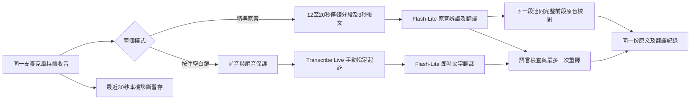

# 語音翻譯：手機與筆電純前端版

## 2.8.2：手機翻譯區放大

手機寬度（600px以下）翻譯紀錄改為約65%螢幕高度、至少360px，上方設定與下方費用可透過整頁捲動查看，不再將字幕擠成小框。收音時收起長篇模式說明。

翻譯紀錄右上角新增「放大閱讀」：暫時收起金鑰、設定、診斷及費用，保留開始／停止、狀態、原文切換、複製下載與空白鍵模式的按住說話按鈕，將剩餘螢幕分配給字幕。按「返回設定」回到一般畫面，不停止翻譯、不清除歷史或費用。電腦版維持原本版面。

## 2.8.1：回聽失敗的原因與暫時故障重試

「精準回聽失敗」代表原音翻譯請求收到HTTP錯誤，不等於沒有收音。新版保留Google回傳的狀態與原因，區分設定、金鑰、專案權限、帳單／點數、額度／速率、模型不存在與服務異常；不會再全部只提示檢查金鑰。訊息會隱藏金鑰、不回顯HTML或整份回應。若需要協助，提供錯誤括號數字及「Google原因」即可，不要提供API Key。

遇到500、502、503、504時，保留同一段原音，等1秒自動重試一次。持續收音與前後文銜接不切換模型；原有20秒整段期限、排隊上限、取消與預算檢查仍適用。其他HTTP錯誤不自動重試，語言修復仍另外限一次。每次嘗試分開計費並計入預算，包括失敗的保守估算；沒有無限重連。

這版改善錯誤判斷與短暫服務故障恢復。使用者回報的失敗原因尚待實際HTTP狀態與Google訊息確認，不能把模擬測試通過當成實際API已恢復。Google的錯誤分類與重試原則見[官方排錯說明](https://ai.google.dev/gemini-api/docs/troubleshooting)。

## 2.8.0：分段時保留完整前後文

精準原音模式不再固定每 12 秒硬切。收到約 12 秒後，優先在至少 0.7 秒的安靜停頓中間分段；連續說話最長等到 20 秒，再保留 3 秒後文才送出。首次通常需要約 15–23 秒加上 AI 處理時間。停頓只影響送出時機，麥克風始終持續收音，小聲、安靜與第一個字的音訊都照常保留。

每次新翻譯會一起送出「完整前一段＋這一段＋3 秒後文」原音，讓 AI 根據後來的否定、轉折與句尾，重新校對前一段的原文和譯文。校對直接更新原本紀錄，複製與下載 TXT 也以最新結果為準，不會另加一份重複譯文。最新一段在收到後文後可能變更；按停止會立即翻譯剩下的尾段，不需要等滿時間。

這是同一次翻譯請求內的前段校對，沒有額外開一套 AI 或新增校對請求；但重聽的原音和回傳內容增加，因此實際音訊及文字用量也會增加，計入台幣估算與預算。正常連續說話時，每次新請求約包含 43 秒原音（20 秒前段＋20 秒新段＋3 秒後文），不代表錄了 43 秒新聲音。內部銜接暫存最多 60 秒，只在頁面記憶體；可手動擷取的診斷原音仍是最近 30 秒。

這項改善適用自動精準模式。空白鍵模式仍依先前選擇保留邊說邊顯示；請盡量完整講完一句再放開。停頓偵測不是語意分析，背景聲、小聲長句及超長句仍可能需要跨段；原音時間歸屬與語意校對由 AI 處理，無法保證完全不漏譯或不重複。

## 2.7.1：自動收音閒置暫停

精準原音翻譯模式開始後，本頁連續 1 小時沒有滑鼠移動、按鍵、觸控或滾輪操作，就會暫停翻譯並關閉收音，保留已完成紀錄與累計費用。回來後按「繼續翻譯」才恢復，不會因滑鼠再次移動自動重開。空白鍵模式不受此規則影響。

其他視窗的操作、語音輸入、AI 回覆及字幕自動捲動不會重新計時。閒置到期會立即取消尚未完成的工作，不再送出新的尾段翻譯；已送出的請求仍可能計費。若瀏覽器在背景或電腦休眠時延遲執行計時，返回頁面時也會檢查已到期的期限。

## 2.7.0：兩個主模式

網站現在只有兩種翻譯模式，新版預設「精準原音翻譯」。選擇會在同一瀏覽器記住；停止後才能切換，換模式／換語言／續講都保留目前紀錄與累計費用。

| 模式 | 如何操作 | 文字何時出現 |
| --- | --- | --- |
| 精準原音翻譯 | 按「開始翻譯」後持續說話，結束按停止 | 約 12–20 秒優先在停頓處分段，加上 3 秒後文及 AI 處理時間；下一段會校對前段 |
| 空白鍵 · 按住說話 | 先按「開始待命」，等顯示「對講機待命」，電腦按住空白鍵／手機按住按鈕說話，放開結束這句 | 按住期間持續顯示原文和譯文，放開後等待定稿再講下一句 |

**精準模式直接使用先前「精準回聽校正」的原音模型作為唯一翻譯流程，不另外執行 Live 聽寫或即時文字翻譯。** 原文與譯文完成後一起進入主要「翻譯紀錄」，沒有第二份回聽區，也不用再勾選額外校正。

空白鍵模式依使用者要求保留「邊說邊顯示」，使用一條 Gemini Transcribe Live 連線及節流後的文字翻譯；沒有同時執行原音回聽。保留按下前最多 0.8 秒、按住期間及放開後約 0.3 秒的聲音。麥克風在待命時保持開啟，未選取的待命聲音不送往 Live；按下前的短暫環境聲可能隨前音一起上傳。

## 日文沒有變成中文的處理

「原文」欄保留日文是正常的；在中文 ↔ 日文配對下，日文的「譯文」欄應是繁體中文。

這次新增來源／目標語言配對與譯文內容檢查，兩個模式皆適用：

- 明確要求日文 → 繁體中文、中文 → 日文，回覆帶出目標語言。
- 若 Live 的語言標記與明確日文假名矛盾，不再把錯誤標記強制交給文字翻譯。
- 發現中文譯文其實仍是明顯日文時，最多重新翻譯一次；重試仍失敗就提示，不標成成功，也不無限重試。額外請求各自計費並納入本場預算。
- 中文原文和譯文以台灣繁體字詞顯示。日文原文維持日文字形。

文字檢查不是完整語言鑑定器，只有共用漢字的短語、人名、地名仍可能無法區分；引用的日文書名也可能保留原文。真實語音的判斷與翻譯仍可能出錯。

## 最簡單使用與更新

根目錄 `index.html` 是已打包好的單一首頁，手機使用不需要 Node.js、不需要自己的後端、不需要 `.env`。

1. 在 GitHub Desktop 提交本次修改並 Push origin；或上傳根目錄 `index.html` 取代原本 GitHub Pages 的同名檔案。
2. 等候 Pages 更新，開啟原本 HTTPS 首頁，確認頁尾是「版本 2.8.2」。必要時重新整理；電腦可按 Ctrl + F5。
3. 貼上自己的 Gemini API Key，選模式及語言配對。支援繁體中文 ↔ 日本語、繁體中文 ↔ English、日本語 ↔ English。
4. 精準模式按「開始翻譯」後說話；空白鍵模式依上方步驟按住說話。同一配對可輪流說兩種語言，不必手動切方向。
5. 結束按停止，等最後一段完成。可複製或下載 TXT，裡面保留各句實際翻譯方向。

已有 GitHub Pages 不必換平台。若來源是分支根目錄，就更新最外層首頁；若來源是 `/docs`，請把成品放進發佈用的 docs。另有手動 GitHub Actions workflow：`.github/workflows/realtime-pages.yml`；它會測試並建置 dist，不需要 Gemini secret。

本次只更新本機檔案，沒有替你提交、推送或遠端發佈。

## 個人設定、紀錄與費用

- API Key 在此裝置、此瀏覽器的 localStorage 記住，下次自動帶入；按「更改金鑰 → 清除」可刪除。Key 不寫入 HTML、GitHub 或 `.env`。不同裝置／瀏覽器各自保存；無痕模式、網站資料被清除或儲存遭阻擋時可能不保留。
- 模式、常用詞、匯率會記住。文字與音訊紀錄只在本頁記憶體保留，重新整理或離開頁面會消失，請先下載。按「清除紀錄」才會一起清除紀錄與累計用量。
- 停止、續講、換模式或換語言不會歸零。每次按開始的「本場預算」仍單獨計算，與跨場次累計總額不同。
- 金額與預算以台幣顯示，參考匯率可調整並記住；收音期間固定使用開始時的匯率，不自動抓即時匯率。
- 精準模式只估算實際原音模型請求，不額外加上沒有使用的 Live 辨識費。累計處理音訊是唯一收進的聲音長度；原音請求音訊另含邊界參考及語言重試，因此可能較長。
- 原音請求送出前保守預留提示、音訊與輸出額度：首次最多 2,048 個輸出 tokens，含前段校對時最多 4,096。收到 metadata 後覆寫估算，不重複相加。失敗或取消的已送出請求仍可能計費。預算不足會停止新請求及收音；這是估算門檻，不是 Google 帳單硬上限。
- 空白鍵模式的 Live 及文字請求、語言重試也會計入費用。各階段不會偷偷切換至另一個主模式。

模型為 `gemini-3.1-flash-lite`（原音翻譯與文字翻譯），空白鍵另用 `gemini-3.5-transcribe-live` 聽寫。費率參考保存在 `src/lib/config.ts`，實際計費請以 [Google 官方價格](https://ai.google.dev/gemini-api/docs/pricing) 與帳單為準。原音能力見 [模型文件](https://ai.google.dev/gemini-api/docs/models/gemini-3.1-flash-lite)。

## 原音與漏字檢查

展開「漏字檢查（原音與辨識稿）」，發現問題時按「擷取最近30秒」，停止後可播放或下載 WAV。只有最近 30 秒循環暫存，擷取後另保留一份固定片段，再次擷取會取代它；播放／下載本身不增加 AI 呼叫。原音不寫入持久儲存，已傳送到 Google 的資料依其服務政策處理。

空白鍵模式可比較語音辨識稿與文字校正後原文；精準模式的原文直接由原音模型產生，沒有另一份 Live 辨識稿。對照與原音不是逐字時間對齊。

原音沒有某字，需先檢查麥克風；原音完整但原文缺字，可能是語音辨識；原文完整而譯文缺字，可能是翻譯。沒有任何模式能保證每字都正確。

## 手機、麥克風與影片

- 使用 HTTPS、新版 Safari／Chrome 一般分頁，允許麥克風，避免通訊軟體內建瀏覽器。
- 手機保持頁面在前景。鎖屏或切 App 會主動停止收音；回來後重新開始。
- 一般使用同一支麥克風收人聲及喇叭外放；戴耳機時通常收不到耳機聲音。網頁關閉回音消除與降噪，保留裝置自動音量調整；實際效果仍受環境及硬體影響。
- 若要直接翻譯播放分頁，可在收合的進階設定選分享分頁音訊，並勾選分享音訊。只傳聲音，不傳畫面；支援度依瀏覽器／系統而異。
- 空白鍵不攔截文字欄位、其他按鈕、組字或 Ctrl／Alt／Command 快捷鍵。切換視窗、手指滑出／取消會釋放按住狀態；等待定稿期間不接受新一輪，避免覆蓋前句。
- 精準模式有網路錯誤、逾時、排隊過多或預算不足時會停止並提示，請保留原音後重新開始；不會自動改跑即時翻譯。

## 開發與本機預覽

只有修改原始碼與本機預覽才需要 Node.js（20.19 以上），使用網站的人不需要安裝。

```powershell
cd realtime-text
npm.cmd install
npm.cmd test
npm.cmd run build
npm.cmd start
```

建置更新 dist 與根目錄 index.html；不要把開發入口 realtime-text/index.html 單獨上傳。預覽器只提供靜態網頁，不代理 Google，也不讀取 .env。保留的 server 與 .env.example 只是早期工程參考。

也可從根目錄執行：

```powershell
node scripts/update-listening.cjs
node scripts/check-page.cjs
node --test tests/continuous-live.test.cjs tests/page-validation.test.cjs
```

不要上傳 `.env`、真正的 Key、node_modules 或 .pnpm-store。建置會檢查衝突標記及主程式／收音工作模組語法。

## 目前架構



完整驗證與限制見 `VERIFICATION.zh-TW.md`。合成音訊與固定 AI 回覆只驗證流程，不能代表真實語音準確率或手機實機結果。
