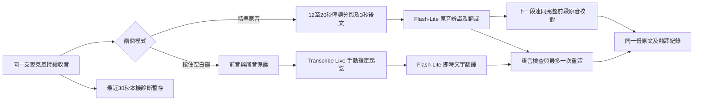

# 語音翻譯：手機與筆電純前端版

## 2.11.2：iPhone 朗讀沒有聲音的處理

使用者回報：iPhone Safari 在 2.11.1 手動按「朗讀」，按鈕變成「停止朗讀」但完全沒有聲音。沒有實體 iPhone 可以重現，這版做的是排除已知原因並讓問題看得見：

- **最可能的原因是 iPhone 的靜音模式**：開發者論壇與 WebKit 錯誤回報都提到，靜音開關打開時網頁的語音合成沒有聲音，網頁偵測不到這個狀態。現在在 iPhone／iPad 上第一次朗讀時，以及勾選自動朗讀後，會提醒關閉靜音模式並調高音量。
- 沒有在收音時，朗讀前會把頁面的音訊類型設為媒體播放（支援 Audio Session API 的 Safari），這個類型不受靜音開關影響。這個設定對語音合成是否有效因系統版本而異，沒有驗證。
- 只指定語言、不再自行從裝置的語音清單挑選語音。原本會挑清單中第一個相符的語音，在 Apple 裝置上可能挑到趣味語音或尚未下載的語音。
- 送出朗讀後 5 秒內裝置既沒有開始也沒有結束，就視為沒有開始：按鈕恢復成「朗讀」，並顯示「這台裝置沒有開始朗讀」。瀏覽器回報錯誤時會顯示錯誤代碼。按鈕不會再一直停在「停止朗讀」。
- 判讀方式：按下後幾秒按鈕自己恢復、沒有任何訊息，表示裝置認為已經唸完，聲音是被靜音模式、音量或輸出裝置擋掉；出現「沒有開始朗讀」或錯誤代碼，則是語音功能本身沒有啟動。

## 2.11.1：手機自動朗讀、朗讀預設關閉

- 手機上勾選了自動朗讀卻不會唸：手機瀏覽器（尤其是 iPhone）只允許在使用者點按的當下開始第一次語音，自動朗讀是翻譯回來後才由程式觸發，因此被擋下。現在會在按開始、勾選朗讀、放開說話鍵這些點按裡先送出一段無聲的語音來解鎖，之後的自動朗讀才能出聲。
- 取消正在唸的內容後改為稍候 0.12 秒再唸下一段，沒有在唸時不再呼叫取消；部分手機瀏覽器會吞掉緊接在取消之後的朗讀。
- 面對面對講的「朗讀譯文」預設改為關閉，要用時再勾選（主頁面的選項或對講畫面中間的按鈕），勾選後會記住。
- 這個修正沒有在實體手機上驗證。若勾選後仍然沒有聲音，另一個可能的原因是 iPhone 在麥克風開啟期間會把語音改由聽筒小聲播放或直接靜音，這是系統行為，網頁無法控制。

## 2.11.0：面對面對講、灰色系新版面

**面對面對講（新的翻譯模式）**

- 翻譯模式選「面對面對講 · 一人按一邊」，按「開始對講」後整個畫面分成兩半：手機放在兩人中間，各自按住靠近自己的按鈕說話，放開後對方那一半顯示翻譯，自己那一半顯示辨識到的原文供確認。按鈕在手機的上下兩端，對面那一半會上下顛倒，讓對面的人正著看；介面文字也用對方的語言（日文或英文）。
- **按哪一側就固定那句話的語言**，不靠辨識服務猜測。只有漢字的短句（例如「東京大学」）不會再被當成中文。只有在文字明顯是另一種語言（中文側出現假名，也就是按錯邊）時才退回自動判斷。
- 同一時間只有一個人能說話：一側按住時另一側的按鈕顯示「對方說話中」，這句翻完才換人。
- 中間的控制列給手機主人使用：「對調」交換兩側語言、「對面顛倒」切換上下顛倒（電腦或兩人看同一方向時關閉，寬螢幕會改成左右並排）、「朗讀譯文」翻完自動唸給對方聽（2.11.1 起預設關閉，使用裝置內建語音）、「結束」回到主頁面。
- 對講的內容照常寫進主頁面的翻譯紀錄，可複製與下載。連線中斷或發生錯誤時對講畫面不會消失，會顯示原因與「重新開始」。
- 沿用按住說話的收音方式：待命時麥克風開著但聲音不送出，按住才送；情境、詞彙、品質設定都適用。分享分頁音訊在這個模式不使用。
- 限制：兩人共用同一支麥克風，環境吵雜或手機離嘴太遠會影響辨識；這個模式的翻譯請求失敗會結束這次對講（要按「重新開始」），不像精準模式會自動重試補翻。

**版面與配色**

- 配色改為中性灰：背景與面板只用深淺不同的灰，主要按鈕是反白的灰，只有收音中、等待、錯誤這類狀態用低彩度的顏色提示。深色與淺色主題都重新調整。
- 電腦改為兩欄：左側是設定欄（自己捲動），右側整個高度留給字幕，展開設定不會再擠壓字幕。
- 手機改為「控制 → 字幕 → 設定」的順序，字幕不會被設定擠到下面；模式與語言各佔一列，不再被截斷。
- 設定收成一張清單（情境與詞彙／品質與速度／顯示與其他／漏字檢查），金鑰設定好之後移到設定區。
- 按住說話的按鈕移到字幕正下方。字幕卡片拿掉彩色邊線，原文較淡、譯文較大。
- 加到主畫面的圖示與主題色改為灰色系（四個檔案仍須和 `index.html` 一起上傳）。

## 2.10.0：品質與速度選項、紀錄自動保存、朗讀、介面整理

**翻譯效果**

- 「品質與速度」設定新增翻譯品質：標準（`gemini-3.1-flash-lite`）或高品質（`gemini-3.8-flash`，思考量 low；該模型不支援 minimal）。兩個翻譯模式都適用，費用估算改用對應價格：輸入每百萬 tokens US$0.75、輸出 US$3.75，Google 公告自 2027-01-01 起加倍（程式已依日期切換）。官方價格頁沒有另列音訊輸入價，以同一輸入價估算。資料於 2026-11-11 查閱[模型](https://ai.google.dev/gemini-api/docs/models)與[價格](https://ai.google.dev/gemini-api/docs/pricing)頁。
- 精準模式新增出字速度：標準（12–20 秒一段、3 秒後文）或快速（6–12 秒一段、2 秒後文）。快速較早看到譯文，請求次數與費用約加倍，句子較容易被切開，要靠下一段的校對接回。
- 每次請求會帶入最近最多 6 組已完成的「原文→譯文」，要求沿用先前的人名、術語與語氣；接續先前紀錄開新場次時也會帶入。
- 整段（含後文）完全沒有訊號時不送出請求：判斷標準是所有樣本的振幅都不超過 2（16-bit），只涵蓋麥克風被靜音、分享的分頁沒有播放這類數位靜音，不是音量門檻，再小聲的人聲都照常送出。有請求進行中或有段落待補翻時不略過，維持原本的銜接。**這改變了先前「純安靜也一律回聽」的行為。**

**使用與操作**

- 翻譯文字自動保存在此瀏覽器（最多 400 句），重新整理或分頁被系統回收後會自動還原；按「清除紀錄」一併刪除。原音片段、用量與費用不保存。
- 語言配對、預算、顯示原文、音訊來源、品質、速度、外觀、字級都會記住。
- 開始與停止合併成一顆按鈕；Ctrl（Mac 為 ⌘）＋ Enter 可開始或停止。
- 手機切到背景而停止後，10 分鐘內回到此頁會自動繼續（可在「顯示與其他」關閉）。手動按停止、發生錯誤或離開超過 10 分鐘不會自動重開麥克風。iPhone 可能因系統限制無法自動恢復收音，這時會提示再按一次開始。
- 朗讀譯文：使用瀏覽器內建語音合成，不呼叫 Gemini、不計費。每段譯文旁有「朗讀」鈕，只在沒有收音，或空白鍵模式待命時出現，避免朗讀聲被麥克風收進去再翻譯一次。空白鍵模式可勾選「每句完成後自動朗讀譯文」，按下說話會立刻中斷朗讀。語音品質與可用語言由裝置決定。
- 可加到手機主畫面：首頁旁新增 `manifest.webmanifest` 與 `icon-192.png`、`icon-512.png`、`icon-180.png`。**發佈時這四個檔案要和 `index.html` 放在同一個資料夾**；只上傳 `index.html` 網站仍可正常使用，只是主畫面沒有名稱與圖示。沒有離線功能。

**介面**

- 模式說明縮成一句，細節收進「運作方式」；費用區平常只顯示一行，點「明細」才展開。
- 「專注閱讀」（原「放大閱讀」）電腦也可使用；字幕可用 A−／A＋ 調整字級。
- 說明文字最小 12–13px 並提高對比；新增淺色主題，預設跟隨系統，可手動選擇。
- 中日文斷行不在標點前後留孤字（支援的瀏覽器會依日文文節斷行）；時間改為 24 小時制。

## 2.9.0：斷線不中止、情境與固定譯法、等待與校正提示

**精準模式遇到暫時性問題不再整場停止。** 斷網、Google 逾時（每次嘗試 20 秒）、429 與 500／502／503／504 會保留同一段原音，間隔 1 秒、3 秒各重試一次（每段最多三次請求），期間麥克風持續收音。仍然失敗就放棄這一段，由下一段的請求連同它的原音一起補翻（精準模式每次本來就帶著前一段原音，所以不必另外重錄）；補翻成功時紀錄沒有缺口。補不回來的範圍會在翻譯紀錄與 TXT 留下「未翻譯」標記，寫明收音位置與原因，不會默默消失。回覆格式不完整、缺少前段校對、語言修復後仍錯誤也照同樣方式處理。

以下情況仍會立即停止並提示：本場預算不足、金鑰／權限／帳單／模型設定類錯誤（400、401、402、403、404、501 等，重試沒有意義），以及連續三段都失敗。停止時尚未翻完的範圍同樣會標示。翻譯跟不上收音時（排隊超過三段）不再停止，改為把沒送出的範圍交給下一段補翻或標示。每次重試與補翻都是獨立請求，各自計費並計入預算；沒有無限重連。

**「情境與詞彙」設定（選填）。** 可填寫場合說明（例如「與日本指導教授討論雙聯學位的修課與研究計畫」）、選擇譯成日文時的語體（自動／丁寧語／敬語／常體），並在常用詞欄用「原詞=譯法」指定固定譯法（例如「雙聯學位=ダブルディグリー」，中日雙向適用，兩邊也都會當作辨識提示）。兩個翻譯模式都會帶入這些設定，並在此瀏覽器記住。提示詞明確要求 AI 只把場合說明當背景，不能當成有人說過的話；固定譯法只在該詞真的出現時套用。語體「自動」會跟隨說話者，沒有線索時用です・ます。這些是給模型的指示，實際遵循程度仍需以真實對話確認。

**等待與校正看得見。** 精準模式收音時，字幕底部顯示「聆聽中，這一段已收 N 秒」與進度條，送出後顯示「正在翻譯剛才的內容」；按開始後不再停留在「按開始翻譯」的空白畫面。最新一段標示「暫定，下一段會再校對」。後文校對若改寫了已顯示的譯文，改動的字會先明顯標亮，之後保留淡色底線，游標停留可看校對前的版本；只有內容真的不同才標示「已校正」（先前每次重送都會標）。

## 2.8.2：手機翻譯區放大

手機寬度（600px以下）翻譯紀錄改為約65%螢幕高度、至少360px，上方設定與下方費用可透過整頁捲動查看，不再將字幕擠成小框。收音時收起長篇模式說明。

翻譯紀錄右上角新增「放大閱讀」：暫時收起金鑰、設定、診斷及費用，保留開始／停止、狀態、原文切換、複製下載與空白鍵模式的按住說話按鈕，將剩餘螢幕分配給字幕。按「返回設定」回到一般畫面，不停止翻譯、不清除歷史或費用。電腦版維持原本版面。

## 2.8.1：回聽失敗的原因與暫時故障重試

「精準回聽失敗」代表原音翻譯請求收到HTTP錯誤，不等於沒有收音。新版保留Google回傳的狀態與原因，區分設定、金鑰、專案權限、帳單／點數、額度／速率、模型不存在與服務異常；不會再全部只提示檢查金鑰。訊息會隱藏金鑰、不回顯HTML或整份回應。若需要協助，提供錯誤括號數字及「Google原因」即可，不要提供API Key。

遇到500、502、503、504時，保留同一段原音，等1秒自動重試一次。持續收音與前後文銜接不切換模型；原有20秒整段期限、排隊上限、取消與預算檢查仍適用。其他HTTP錯誤不自動重試，語言修復仍另外限一次。每次嘗試分開計費並計入預算，包括失敗的保守估算；沒有無限重連。

這版改善錯誤判斷與短暫服務故障恢復。使用者回報的失敗原因尚待實際HTTP狀態與Google訊息確認，不能把模擬測試通過當成實際API已恢復。Google的錯誤分類與重試原則見[官方排錯說明](https://ai.google.dev/gemini-api/docs/troubleshooting)。

## 2.8.0：分段時保留完整前後文

精準原音模式不再固定每 12 秒硬切。收到約 12 秒後，優先在至少 0.7 秒的安靜停頓中間分段；連續說話最長等到 20 秒，再保留 3 秒後文才送出。首次通常需要約 15–23 秒加上 AI 處理時間。停頓只影響送出時機，麥克風始終持續收音，小聲、安靜與第一個字的音訊都照常保留。

每次新翻譯會一起送出「完整前一段＋這一段＋3 秒後文」原音，讓 AI 根據後來的否定、轉折與句尾，重新校對前一段的原文和譯文。校對直接更新原本紀錄，複製與下載 TXT 也以最新結果為準，不會另加一份重複譯文。最新一段在收到後文後可能變更；按停止會立即翻譯剩下的尾段，不需要等滿時間。

這是同一次翻譯請求內的前段校對，沒有額外開一套 AI 或新增校對請求；但重聽的原音和回傳內容增加，因此實際音訊及文字用量也會增加，計入台幣估算與預算。正常連續說話時，每次新請求約包含 43 秒原音（20 秒前段＋20 秒新段＋3 秒後文），不代表錄了 43 秒新聲音。內部銜接暫存最多 60 秒，只在頁面記憶體；可手動擷取的診斷原音仍是最近 30 秒。

這項改善適用自動精準模式。空白鍵模式仍依先前選擇保留邊說邊顯示；請盡量完整講完一句再放開。停頓偵測不是語意分析，背景聲、小聲長句及超長句仍可能需要跨段；原音時間歸屬與語意校對由 AI 處理，無法保證完全不漏譯或不重複。

## 2.7.1：自動收音閒置暫停

精準原音翻譯模式開始後，本頁連續 1 小時沒有滑鼠移動、按鍵、觸控或滾輪操作，就會暫停翻譯並關閉收音，保留已完成紀錄與累計費用。回來後按「繼續翻譯」才恢復，不會因滑鼠再次移動自動重開。空白鍵模式不受此規則影響。

其他視窗的操作、語音輸入、AI 回覆及字幕自動捲動不會重新計時。閒置到期會立即取消尚未完成的工作，不再送出新的尾段翻譯；已送出的請求仍可能計費。若瀏覽器在背景或電腦休眠時延遲執行計時，返回頁面時也會檢查已到期的期限。

## 2.7.0：兩個主模式

網站現在只有兩種翻譯模式，新版預設「精準原音翻譯」。選擇會在同一瀏覽器記住；停止後才能切換，換模式／換語言／續講都保留目前紀錄與累計費用。

| 模式 | 如何操作 | 文字何時出現 |
| --- | --- | --- |
| 精準原音翻譯 | 按「開始翻譯」後持續說話，結束按停止 | 約 12–20 秒優先在停頓處分段，加上 3 秒後文及 AI 處理時間；下一段會校對前段 |
| 空白鍵 · 按住說話 | 先按「開始待命」，等顯示「對講機待命」，電腦按住空白鍵／手機按住按鈕說話，放開結束這句 | 按住期間持續顯示原文和譯文，放開後等待定稿再講下一句 |

**精準模式直接使用先前「精準回聽校正」的原音模型作為唯一翻譯流程，不另外執行 Live 聽寫或即時文字翻譯。** 原文與譯文完成後一起進入主要「翻譯紀錄」，沒有第二份回聽區，也不用再勾選額外校正。

空白鍵模式依使用者要求保留「邊說邊顯示」，使用一條 Gemini Transcribe Live 連線及節流後的文字翻譯；沒有同時執行原音回聽。保留按下前最多 0.8 秒、按住期間及放開後約 0.3 秒的聲音。麥克風在待命時保持開啟，未選取的待命聲音不送往 Live；按下前的短暫環境聲可能隨前音一起上傳。

## 日文沒有變成中文的處理

「原文」欄保留日文是正常的；在中文 ↔ 日文配對下，日文的「譯文」欄應是繁體中文。

這次新增來源／目標語言配對與譯文內容檢查，兩個模式皆適用：

- 明確要求日文 → 繁體中文、中文 → 日文，回覆帶出目標語言。
- 若 Live 的語言標記與明確日文假名矛盾，不再把錯誤標記強制交給文字翻譯。
- 發現中文譯文其實仍是明顯日文時，最多重新翻譯一次；重試仍失敗就提示，不標成成功，也不無限重試。額外請求各自計費並納入本場預算。
- 中文原文和譯文以台灣繁體字詞顯示。日文原文維持日文字形。

文字檢查不是完整語言鑑定器，只有共用漢字的短語、人名、地名仍可能無法區分；引用的日文書名也可能保留原文。真實語音的判斷與翻譯仍可能出錯。

## 最簡單使用與更新

根目錄 `index.html` 是已打包好的單一首頁，手機使用不需要 Node.js、不需要自己的後端、不需要 `.env`。

1. 在 GitHub Desktop 提交本次修改並 Push origin；或上傳根目錄 `index.html` 取代原本 GitHub Pages 的同名檔案。
2. 等候 Pages 更新，開啟原本 HTTPS 首頁，確認頁尾是「版本 2.11.2」。必要時重新整理；電腦可按 Ctrl + F5。
3. 貼上自己的 Gemini API Key，選模式及語言配對。支援繁體中文 ↔ 日本語、繁體中文 ↔ English、日本語 ↔ English。
4. 精準模式按「開始翻譯」後說話；空白鍵模式依上方步驟按住說話。同一配對可輪流說兩種語言，不必手動切方向。
5. 結束按停止，等最後一段完成。可複製或下載 TXT，裡面保留各句實際翻譯方向。

已有 GitHub Pages 不必換平台。若來源是分支根目錄，就更新最外層首頁；若來源是 `/docs`，請把成品放進發佈用的 docs。另有手動 GitHub Actions workflow：`.github/workflows/realtime-pages.yml`；它會測試並建置 dist，不需要 Gemini secret。

本次只更新本機檔案，沒有替你提交、推送或遠端發佈。

## 個人設定、紀錄與費用

- API Key 在此裝置、此瀏覽器的 localStorage 記住，下次自動帶入；按「更改金鑰 → 清除」可刪除。Key 不寫入 HTML、GitHub 或 `.env`。不同裝置／瀏覽器各自保存；無痕模式、網站資料被清除或儲存遭阻擋時可能不保留。
- 模式、場合說明、日文語體、常用詞與固定譯法、匯率會記住。翻譯文字自動保存在此瀏覽器，重新整理後會還原；原音片段與累計用量只在本頁記憶體保留，重新整理或離開頁面會消失。按「清除紀錄」會一起清除保存的文字、原音片段與累計用量。
- 停止、續講、換模式或換語言不會歸零。每次按開始的「本場預算」仍單獨計算，與跨場次累計總額不同。
- 金額與預算以台幣顯示，參考匯率可調整並記住；收音期間固定使用開始時的匯率，不自動抓即時匯率。
- 精準模式只估算實際原音模型請求，不額外加上沒有使用的 Live 辨識費。累計處理音訊是唯一收進的聲音長度；原音請求音訊另含邊界參考及語言重試，因此可能較長。
- 原音請求送出前保守預留提示、音訊與輸出額度：首次最多 2,048 個輸出 tokens，含前段校對時最多 4,096。收到 metadata 後覆寫估算，不重複相加。失敗或取消的已送出請求仍可能計費。預算不足會停止新請求及收音；這是估算門檻，不是 Google 帳單硬上限。
- 空白鍵模式的 Live 及文字請求、語言重試也會計入費用。各階段不會偷偷切換至另一個主模式。

模型預設為 `gemini-3.1-flash-lite`（原音翻譯與文字翻譯；選「高品質」時改用 `gemini-3.8-flash`），空白鍵另用 `gemini-3.5-transcribe-live` 聽寫。費率參考保存在 `src/lib/config.ts`，實際計費請以 [Google 官方價格](https://ai.google.dev/gemini-api/docs/pricing) 與帳單為準。原音能力見 [模型文件](https://ai.google.dev/gemini-api/docs/models/gemini-3.1-flash-lite)。

## 原音與漏字檢查

展開「漏字檢查（原音與辨識稿）」，發現問題時按「擷取最近30秒」，停止後可播放或下載 WAV。只有最近 30 秒循環暫存，擷取後另保留一份固定片段，再次擷取會取代它；播放／下載本身不增加 AI 呼叫。原音不寫入持久儲存，已傳送到 Google 的資料依其服務政策處理。

空白鍵模式可比較語音辨識稿與文字校正後原文；精準模式的原文直接由原音模型產生，沒有另一份 Live 辨識稿。對照與原音不是逐字時間對齊。

原音沒有某字，需先檢查麥克風；原音完整但原文缺字，可能是語音辨識；原文完整而譯文缺字，可能是翻譯。沒有任何模式能保證每字都正確。

## 手機、麥克風與影片

- 使用 HTTPS、新版 Safari／Chrome 一般分頁，允許麥克風，避免通訊軟體內建瀏覽器。
- 手機保持頁面在前景。鎖屏或切 App 會主動停止收音；10 分鐘內回來會自動繼續，超過則需再按開始。
- 一般使用同一支麥克風收人聲及喇叭外放；戴耳機時通常收不到耳機聲音。網頁關閉回音消除與降噪，保留裝置自動音量調整；實際效果仍受環境及硬體影響。
- 若要直接翻譯播放分頁，可在收合的進階設定選分享分頁音訊，並勾選分享音訊。只傳聲音，不傳畫面；支援度依瀏覽器／系統而異。
- 空白鍵不攔截文字欄位、其他按鈕、組字或 Ctrl／Alt／Command 快捷鍵。切換視窗、手指滑出／取消會釋放按住狀態；等待定稿期間不接受新一輪，避免覆蓋前句。
- 精準模式遇到網路錯誤、逾時或服務暫時異常會自動重試並由下一段補翻，收音不中斷；預算不足、金鑰或權限問題、連續三段失敗才會停止並提示。不會自動改跑即時翻譯。

## 開發與本機預覽

只有修改原始碼與本機預覽才需要 Node.js（20.19 以上），使用網站的人不需要安裝。

```powershell
cd realtime-text
npm.cmd install
npm.cmd test
npm.cmd run build
npm.cmd start
```

建置更新 dist 與根目錄 index.html；不要把開發入口 realtime-text/index.html 單獨上傳。預覽器只提供靜態網頁，不代理 Google，也不讀取 .env。早期的後端程式（`server/`、`dist-server/`、`tsconfig.server.json` 及其兩個測試）已於 2.10.0 之後移除；`.env.example` 與 package.json 裡的 express／ws／dotenv 是那時留下的，網站沒有使用。

也可從根目錄執行：

```powershell
node scripts/update-listening.cjs
node scripts/check-page.cjs
node --test tests/continuous-live.test.cjs tests/page-validation.test.cjs
```

不要上傳 `.env`、真正的 Key、node_modules 或 .pnpm-store。建置會檢查衝突標記及主程式／收音工作模組語法。

## 目前架構



完整驗證與限制見 `VERIFICATION.zh-TW.md`。合成音訊與固定 AI 回覆只驗證流程，不能代表真實語音準確率或手機實機結果。
